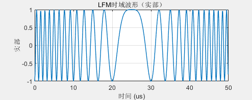
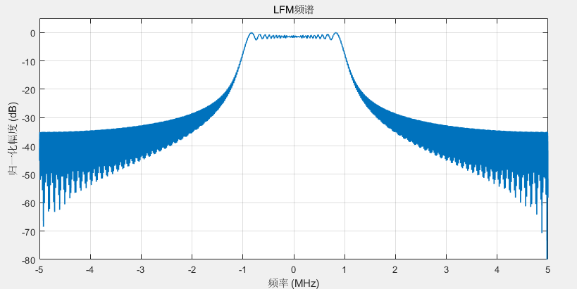
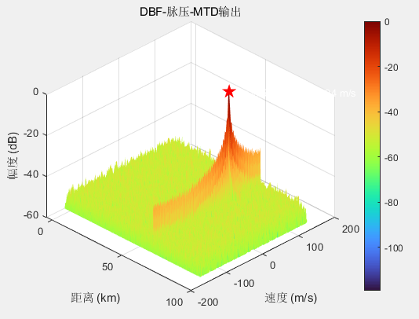
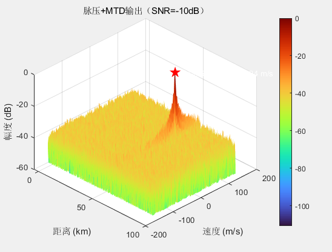
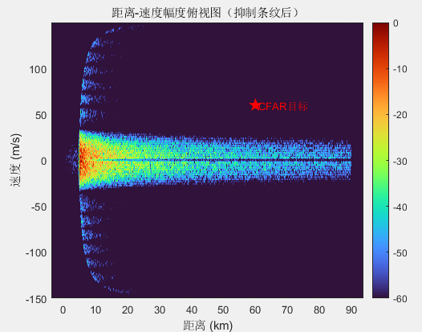
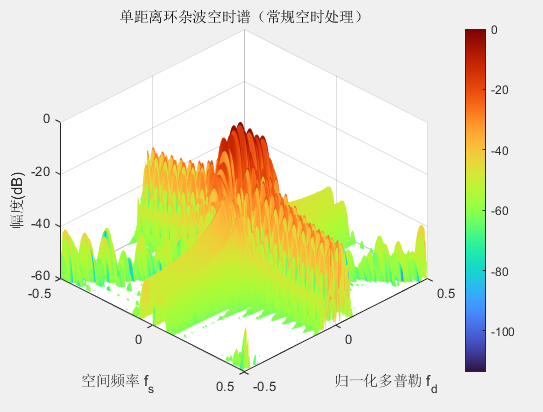
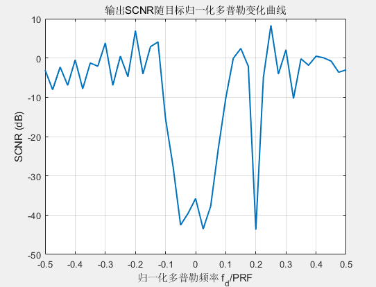

# Full-Link Simulation of Airborne Radar Target Detection and Clutter Rejection from Pressure Waveform to Space-Time Adaptive Processing [with MATLAB Code]

Airborne Radar Target Detection and Clutter Reduction Full-Link Simulation: From Pressure Waveform to Space-Time Adaptive Processing
This paper takes a complete simulation system as an example, outlining the theoretical link of airborne pulse Doppler radar signal processing. It covers key steps such as waveform design, matched filtering, pulse accumulation, array beamforming, ground clutter modeling, space-time spectrum analysis, and constant false alarm detection.

Introduction: When operating in a downward visibility mode, airborne radar inevitably receives strong backscatter from the ground, known as ground clutter. Due to the movement of the carrier platform, clutter has different Doppler shifts at different azimuths, forming coupling in both the spatial and temporal domains, severely limiting the detection of slow-moving targets. To address this issue, modern airborne radars generally adopt pulse Doppler systems and employ digital beamforming and space-time adaptive processing techniques for clutter suppression.

To deeply understand these technologies and establish a top-down simulation verification platform is crucial. This paper, based on a complete MATLAB simulation chain, describes the entire process from waveform generation to target detection by a forward-looking airborne radar, providing detailed mathematical models and design ideas for each module, and analyzing the physical laws reflected in the simulation results.

System Model and Parameter Design: A S-band airborne radar is simulated with a working frequency of GHz, using a 20-element uniform linear array with an element spacing of m and aiming at the forward side looking. The platform height is km, speed is m/s. The target is located at 60 km away with a radial velocity of 60 m/s.
Waveforms are linear frequency modulated pulses with a bandwidth of MHz, pulse width of μs, and a frequency modulation slope. The pulse repetition frequency is kHz, and the phase-coherent processing interval (CPI) includes 64 or 256 pulses. The receiver samples at MHz.
Key parameters in the radar equation include: 1 kW of elemental transmit power, antenna gain equal to the square of the number of elements (ideally in phase), system loss of 1.5, noise figure of 3, backward scattering coefficient, target RCSm². These parameters provide a basis for quantitative calculations of clutter and target power.
III. Linear Frequency Modulation (LFM) Waveform and Matched Filter Transmitted Signal:
The fuzzy function of this signal is defined by the autocorrelation and cross-correlation under Doppler shift:
Both theoretical analysis and simulation results indicate that the LFM signal's fuzzy plot presents a serrated blade shape, demonstrating good range resolution and Doppler tolerance. However, there is a phenomenon of range-Doppler coupling: Doppler mismatch can cause ranging errors, which require compensation in dynamic Doppler scenarios.
Receiver side employs a matched filter to achieve pulse compression. The output of the matched filter is the autocorrelation function of the transmitted signal, with a main lobe width of approximately 10 dB and a peak sidelobe ratio of -13.2 dB (rectangular envelope). In an unnoised environment, the target echo at 60 km distance after pulse compression exhibits a sharp peak, with the range resolution entirely determined by the bandwidth.
IV. Pulse Doppler Processing and Moving Target Detection in Phase-Coherent Pulse-Train Systems:
In phase-coherent pulse-train systems, target echoes are Doppler modulated in the slow time dimension. The sampling signal for each pulse can be written as:
Where T is the pulse repetition period. After pulse compression at the receiving end, a two-dimensional data matrix in slow time-fast time is obtained. Conducting discrete Fourier transform on the slow time dimension realizes moving target detection (MTD). MTD is equivalent to a set of Doppler filters, each corresponding to a radial velocity channel.
Simulation results show that adding complex Gaussian white noise with a SNR of -10 dB to the echoes results in a very low original SNR, making it difficult for a single pulse to detect a target. However, after accumulation of 64 points in slow time FFT, the signal energy is coherently added, while the noise power is non-coherently accumulated, achieving about 18 dB of phase-coherent gain. The target becomes clearly visible on the range-Doppler plot, and the estimated distance and velocity are consistent with the true values.
V. Array Antennas and Digital Beamforming:
To achieve spatial resolution and improve antenna gain, a 20-element uniform linear array is used, with a Hamming window of -30 dB sidelobes for amplitude weighting. The complex directional pattern of the array is:
When the beam pointing angle is, the DBF weight vector is set to. At this time, the signals received by various elements of the array are added in phase, resulting in a significant gain in direction and suppression in other directions.
In the simulation, a 30° target echo was fed into the array, and after DBF, pulse compression and MTD were performed successively. The results show that not only does DBF accurately extract the target angle, but also through array gain and window function sidelobe suppression, it effectively reduces potential interference from other angles, providing spatial purity for target detection.
VI. Airborne Ground Clutter Modeling In airborne radar operation at low-altitude, ground clutter is the primary background interference. The basic idea of clutter modeling is to divide the ground within the radar line of sight into a series of distance rings, and then split each ring into multiple independent clutter blocks based on azimuth angle. The radar cross section (RCS) of each clutter block is given by the radar equation:
where is the ground illuminated area of the block, is the range resolution, and is the azimuth angle interval.
For clutter blocks located at distance, elevation angle, and azimuth angle, their normalized spatial frequency and Doppler frequency are respectively:
In an oblique side-looking array, the spatial frequency is approximately linear with normalized Doppler frequency, so clutter is distributed along a diagonal line on the angle-Doppler plane, known as clutter spines.
The amplitude of each clutter block's echo is also modulated by the transmit and receive directional patterns, and an independent complex Gaussian random variable is added to simulate the fluctuation caused by the interference of many scattering bodies. By summing up the space-time two-dimensional steering vectors of all clutter blocks according to their amplitudes, we get the space-time quicksnapshot of the distance ring:
where and are the time-domain and space-domain steering vectors, representing Kronecker products. This model precisely characterizes the spatial-temporal coupling structure of clutter, which is the basis for STAP processing.
VII. Spatio-Temporal Spectrum and Clutter Characteristics for Single Range Ring
Perform a two-dimensional Fourier transform on the clutter spatio-temporal fast sweep, and you will obtain its angle-Doppler spectrum. Simulation results show that clutter energy is highly concentrated on a "ridge" that slopes at an angle, with the position of the ridge perfectly aligned with theoretical predictions. The main lobe clutter corresponds to the ground area illuminated by the array's main beam, typically with the strongest energy near zero Doppler; the sidelobe clutter is distributed across other parts of the ridge.
This spatio-temporal spectrum intuitively reveals: traditional one-dimensional clutter suppression methods (either time-domain MTI or space-domain beam nulling) are insufficient to completely eliminate clutter, necessitating two-dimensional joint processing. This is precisely where the starting point of Spatio-Temporal Adaptive Processing (STAP) lies — through adaptive computation of two-dimensional filter weights, creating a notch along the clutter ridge in the angle-Doppler plane.
VIII. Full-Linkage Simulation and CFAR Detection
Combining target echoes, multi-range ring clutter, and receiver thermal noise into a complete data cube (element × pulse × range gate). To enhance computational efficiency, directly construct channel data after beamforming without loop operations over all dimensions.
After range-Doppler compression, perform a simple MTI process in the slow time dimension (subtracting the mean of the pulse dimension), initially suppressing strong main lobe clutter near zero Doppler; then implement pulse Doppler processing through weighted FFT to obtain the final distance-Doppler plot.
On this plot, it is clearly observed that the clutter ridge and target points superimposed on it can be seen. To achieve automatic detection, employ a two-dimensional unit average constant false alarm (CA-CFAR) algorithm. By setting protection windows and training windows in both range and Doppler dimensions, using the average power of training units as an estimate of background clutter and noise power, and multiplying this by a threshold coefficient to obtain an adaptive threshold. Units whose amplitude exceeds the threshold are judged as detected. Simulation successfully detects a target near the target, estimating the distance to be 60.00 km and speed to be 60.00 m/s, which is highly consistent with the set values.
IX. Output SCNR Maintains clutter and noise background unchanged as the target Doppler varies, sweeping from -0.5 to 0.5 in normalized Doppler frequency, and calculating the output signal-to-clutter-and-noise ratio (SCNR) for each Doppler channel. The SCNR is defined as the ratio of the channel signal power to the mean interference power of several adjacent channels.
The SCNR curve exhibits a typical "valley" characteristic: it sharply decreases in the main lobe clutter region (near zero Doppler), even entering deep nulls, reflecting the radar's minimum detectable velocity (MDV) limitation; however, in the high Doppler region beyond the clutter peak, SCNR significantly increases, making targets easier to detect. This curve provides a quantitative reference for the selection of PRF, beam pointing optimization, and STAP performance assessment in radar system design.
X. Conclusion This paper presents the full process of signal processing from waveform design to target detection in airborne pulsed Doppler radar through theoretical derivation combined with simulation verification. From the fuzzy function and matched filtering characteristics of LFM, to the phase-coherent accumulation of pulsed Doppler, to array beamforming and space-time clutter modeling, and finally, through CFAR automatic extraction of targets and analysis of output SCNR characteristics, a logically tight and physically clear simulation research chain is formed.
This simulation platform not only helps understand the intrinsic principles of each module but also serves as a foundation for the development and verification of more complex algorithms (such as STAP and its dimensionality reduction variants, space-time-frequency three-dimensional processing, etc.). Through this systematic review, we hope to provide valuable references for learners and engineers in the field of radar signal processing.

## Images

<!-- PAYMENT_BLOCK -->

## Get this dataset

- Payment link (Stripe): [Buy now](https://buy.stripe.com/3cs8yP7sY87d0vu9AB)
- Payment QR code: 

<!-- /PAYMENT_BLOCK -->
